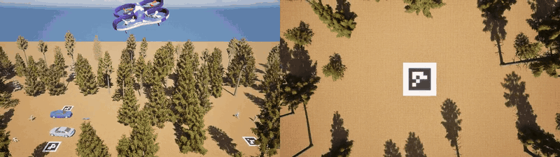

# Drone Autonomy Sim: Detection, Precision Drop and Search-and-Rescue

**English** · [Türkçe](README.tr.md)

A rotary-wing drone in Unreal Engine 5.8 + [Cosys-AirSim](https://github.com/Cosys-Lab/Cosys-AirSim) + **PX4**
that searches an area on its own, detects cars and people with its downward camera, aligns over the target,
drops a package and lands on an **ArUco helipad using vision only**.



**Demo:** left, chase camera; right, the drone's downward camera. The drone locks onto a car (red box), aligns
over its roof and releases the package from **25 m**; first contact is on the roof, 10 cm from its centre.
Full mission with landing: [docs/videos/arac_ustu.mp4](docs/videos/arac_ustu.mp4) (~33 s, 2× speed,
AirSim flight controller).

The mission code is simulator-agnostic (vehicle / camera / payload interfaces): the same `autonomy.py` runs on
AirSim's flight controller, on PX4 SITL and, with the real back ends swapped in, on a physical PX4 drone.
Real-drone guide: [docs/GERCEK_DRONE.md](docs/GERCEK_DRONE.md) · design decisions with evidence:
[docs/TEKNIK_KARARLAR.md](docs/TEKNIK_KARARLAR.md) (both in Turkish).

```
            ┌───────────── autonomy.py (search / detect / align / drop / land, safety) ─────────────┐
 vehicle.py │ AirSimVehicle (SimpleFlight)   │  Px4Vehicle ── MAVSDK/MAVLink ──> PX4 (SITL / Pixhawk) │
 camera     │ AirSim simGetImages            │  camera.OpenCVCamera (USB / CSI / RTSP)               │
 payload    │ payload.SimPayload (physics)   │  payload.GripperPayload (PX4 gripper)                 │
            └──────────────────────────────────────────────────────────────────────────────────────┘
```

## Highlights

| What | Result |
|---|---|
| **Drop onto the car roof from 25 m** (default mode, fine alignment) | first contact on the target roof, **10–12 cm** from its centre |
| **Drop onto the car roof from 50 m / 75 m** | **3/3** at 3–11 cm (50 m) and **3/3** at 5–23 cm (75 m) from the roof centre; helipad landing 0–1 cm |
| Drop onto a marked drop zone next to the car from 25 m, 3 missions × 3 packages | **9/9**, mean **4.8 cm** from the marker centre (was 0.50 m before fine alignment) |
| Fully autonomous mission on **PX4 SITL** (MAVSDK, gimbal camera), 4 missions × 3 packages | **12/12** hits, 12 different cars, 0 false alarms; also **9/9 in 5–8 m/s wind** |
| **Vision-only precision landing** (ArUco, tilt-compensated) | **0–1 cm** (AirSim), ~7 cm (PX4) |
| **Search-and-rescue** in 3 biomes, 3 missions × 3 aid packages | **9/9 safe deliveries, 0 dangerous**, 5.4–6.6 m from the person (limit ≥ 5 m) |
| Car detector trained **only on simulation**, tested on real drone images (VisDrone) | mAP50 **0.02**: sim-only does not transfer |
| Same detector trained on **sim + real data** | cars mAP50 **0.89** on real images, 0.88 in sim |
| Person detection after adding 5 biomes, 32 posed people and real SAR data (HERIDAL) | sim **0.19 → 0.56**, HERIDAL **0.26 → 0.68**, VisDrone 0.59 → 0.62 |
| **Wind:** 5 m/s crosswind, drop onto the roof from 25 m with drag + wind physics | no compensation **0/3** (5.9–8.2 m off); true wind **3/3, 3–11 cm**; wind estimated from the drone's own tilt: **3/3** in an easterly wind (0.8–1.4 m), 1/3 in a diagonal wind (direction-dependent calibration next) |
| Negative test: 40 % of drop-zone markers removed | **0** deliveries to unmarked cars |
| Simulator-free tests (fake vehicle, closed loop) | **53** tests, ~1.5 s |

"Hit" means the package's **first contact** point is on the target car's top-down footprint (another car, a tree
or the ground are counted separately). Full results table: [README.tr.md](README.tr.md#sonuçlar-şimdiye-kadar).

## Lessons learned
- **A per-frame train/val split lies.** Consecutive frames are nearly identical; the first forest model scored
  0.81 on validation yet missed the car right below it in live flight. Splitting by flight session (and keeping
  the split stable as data grows) made the metric honest.
- **Alignment must track.** Picking "the box nearest the image centre" jumped to a neighbouring car when the
  target vanished for one frame (three packages ended up on one car). Tracking the previous box with a jump
  limit and a few frames of miss tolerance fixed it.
- **Compensate camera tilt, or better, use a gimbal.** A drone drifting at 2 m/s tilts ~10°, a 4–5 m error at
  25 m. On PX4 the attitude and the camera frame arrive at different times; a stabilized gimbal camera
  (pitch −89.9°: exactly −90° causes gimbal lock) cut the error to ±0.2 m and PX4 missions went to 12/12.
- **Simulation ≠ reality.** 0.84 in sim, 0.02 on real images. Mixing in real aerial data (VisDrone, HERIDAL)
  fixed transfer without losing sim accuracy.
- **Decompose the error before fixing it.** The 25 m drop error looked like a constant ~0.55 m bias. Logging the
  drone's offset and the fall drift separately showed it was all alignment (30 cm tolerance, releasing before
  fully stopped); an 8-frame average with a 12 cm tolerance brought it to 4.8 cm.
- **Test the measurement code too.** Unreal updates object poses at ~45 Hz; polling faster returned repeated
  poses that the impact detector read as "velocity zero = impact" mid-fall. Impact speed from a single interval
  was also ~30 % too high. Both are now unit-tested.

## Scope and safety
- Default mission: find a car, hover and release onto its **roof** from 25 m (`--mod roof`). Delivery to a
  marked drop zone next to the car is `--mod dropzone`.
- Search-and-rescue: aid packages are dropped **at least 5 m from people** on open ground, the zone is
  re-checked right before release (car drops too: no release if anyone is within 5 m of the impact point), and in real-world mode **every release needs pilot approval** (silence = no).
- Release-point calculation for drops from a **moving** drone (ballistic aiming) is deliberately not built,
  and payloads are never aimed at people.
- Geofence, battery and mission-time aborts; PX4's own geofence/RTL on top.

## Layout

```
mission/autonomy.py           Portable mission core (search, detect, align, drop, land, safety)
mission/sar.py                Search-and-rescue: find a person, drop aid at a safe open spot
mission/vehicle.py            Vehicle interface: AirSimVehicle, Px4Vehicle (MAVSDK)
mission/perception.py         YOLO detection + tilt-compensated pixel-to-ground geometry
mission/aruco_land.py         Vision-only precision landing on an ArUco marker
mission/ballistics.py         Fall with drag + wind, release offset, wind from tilt (opt-in)
mission/world.py              Per-round biome randomization (5 biomes, random clearings)
mission/payload.py, camera.py Payload release (sim / gripper / winch), real camera (OpenCV)
mission/run_autonomy.py       Run a mission in simulation (--backend airsim|px4)
mission/run_real.py           Real drone: bench / connect / mission (with explicit approvals)
mission/record_video.py       Two-camera demo video recorder
mission/sim.sh                Start/stop the simulation with one command (px4|airsim|stop)
unreal/setup_forest.py        Builds the map in the editor: forest, cars, people, helipad, biome pools
training/                     Dataset prep, VisDrone/HERIDAL conversion, training, evaluation
tests/                        Simulator-free tests
docs/                         Real-drone guide, technical decisions log, demo video
```

## Running

```
bash mission/sim.sh airsim          # or: px4 (Unreal + PX4 SITL in WSL)
python mission/run_autonomy.py --model <best.pt> --backend airsim --teslimat 3
#   --mod roof (default) | dropzone | sar        --imgsz 1280 for SAR
#   --hedef araba | insan | ikisi                 target filter (ikisi = cars and people in one mission)
#   --biyom rastgele                              random biome per mission
#   --ruzgar 6,3   --paket-fizigi gercekci   --ruzgar-telafi egim     wind, drag, wind compensation
python -m pytest tests -q
```

CLI flags and log messages are in Turkish (`teslimat` = deliveries, `irtifa` = altitude, `ruzgar` = wind).

## Roadmap
- [x] Autonomous search, YOLO detection, tracking alignment, vision-only landing
- [x] PX4 SITL, wind robustness, drop-zone mode, negative test
- [x] Sim-to-real detector (sim + VisDrone + HERIDAL), 5 biomes, 32 posed people
- [x] Search-and-rescue with a ≥ 5 m safety distance (9/9 safe, 0 dangerous)
- [x] Roof drop with fine alignment (25 m: ~10 cm from the roof centre)
- [x] Wind compensation math validated in sim (true wind: 3/3 roof hits in 5 m/s wind)
- [x] In-flight wind estimate from tilt (easterly 5 m/s: 3/3 roof hits)
- [ ] Direction-dependent wind calibration (diagonal wind: 1/3)
- [x] Drops from 50 m (3/3, 3–11 cm) and 75 m (3/3, 5–23 cm)
- [x] Target filter `--hedef araba|insan|ikisi` and mixed mission (cars → roof, people → aid ≥ 5 m away); person check before every car drop (offline-tested, sim test pending)
- [ ] Map-based mission planning UI
- [ ] Fixed-wing version

## License and usage rights

**Copyright © 2026 Sanberk Doruk Çankaya ([Felix-sof](https://github.com/Felix-sof)). All rights reserved.**

This repository is **not** open source. No part of the code, documentation or other content may be used,
copied, modified or distributed without written permission. Details: [LICENSE](LICENSE).

Third-party components (Unreal Engine, Cosys-AirSim, PX4, MAVSDK, OpenCV, Ultralytics YOLO, map assets) and
the training datasets (VisDrone, HERIDAL) are not included in this repository and are subject to their own
licenses.
